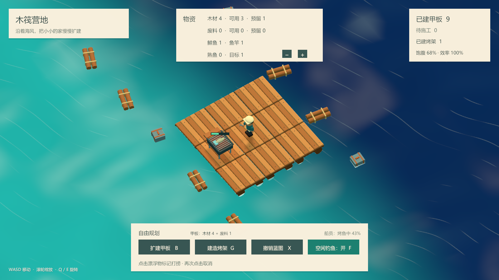

# 木筏漂流经营游戏

面向 PC 的上帝视角轻松经营游戏。玩家从一个人的小木筏开始，通过收集、生产、自由扩建和招募船员，逐步建立舒适的海上小社区。

本文记录已讨论的设计方向，作为后续原型和内容制作的依据。除“当前实现”中明确列出的内容外，文中玩法属于计划内容。游戏名称尚未确定。

## 项目基础

- 引擎：Unity 2022.3.62f2。
- 目标平台：PC。
- 主要操作：鼠标下达指令，键盘辅助操作。
- 当前阶段：钓鱼、烤架生产、自动进食与自由扩建原型。

## 当前实现：木筏、钓鱼、烤鱼、进食与自动施工

打开 `Assets/Scenes/RaftPreview.unity` 后点击 Play，即可规划扩建、标记漂浮物，并让开局船员自动打捞和施工。开局提供一根鱼竿，船员空闲时会到木筏边缘钓鱼。按 `G` 放置烤架蓝图，建好后自动把鲜鱼烤成熟鱼，饥饿时自动进食。材料不足时蓝图等待，打捞补料后自动继续。配置读取、系统初始化和更新由 `GameManager` 统一组织。

- 起始木筏为 3 × 3 块甲板，每格 2 米；模型包含倒角木板、圆木浮筒、绳索和钉子。
- `BuildManager` 管理网格占用、已建甲板、待施工蓝图及施工状态。
- 支持沿现有甲板或蓝图的四边连续扩建；禁止重叠、仅对角连接和超出规划范围的放置。
- 预览有效时为绿色，无效时为红色；放置后的蓝图为蓝色。
- 支持撤销尚未完工的蓝图，包括船员正在前往或正在施工的目标；如果撤销会让其他蓝图失去与已建木筏的连接，需要先撤销外围蓝图。
- 放置蓝图不扣材料；船员到达施工点、准备开工时预留材料，完工时从库存总量结算，取消或中断施工时释放预留。
- 船员已接入 `TryBeginConstruction` / `TryCompleteConstruction` 与 `Planned → Constructing → Complete` 状态，按时间推进施工。开始施工要求相邻格已有正式甲板，船员始终站在正式甲板上工作。
- 经营暂停时仍可规划。甲板使用固定高度，保持建造视野稳定。

### 物资与打捞

- `ResourceManager` 管理木材、废料、鲜鱼、熟鱼的总量、预留量与可用量，始终满足“总量 = 可用 + 预留”。预留归属于具体蓝图或生产、进食任务对象，重复结算或释放不会重复增减库存。
- 当前测试数值：开局 8 木材、2 废料；每块甲板消耗 4 木材、1 废料；一捆漂浮木材提供 2 木材，一箱漂浮废料提供 1 废料。
- `SalvageManager` 沿海流持续生成木材与废料。新物资从木筏两侧的水域出现，生成位置根据已建甲板范围计算。
- 退出建造工具后，点击漂浮物标记打捞，再次点击取消；金色圈表示已经标记，不代表物资当前一定够得着。
- 船员只能从可达的已建甲板边缘打捞。默认距离以甲板格中心计算，水平距离不超过 2.8 米，打捞用时 1.2 秒，不会下水或穿过海面。
- 物资保持漂流；太远的标记会等待物资靠近，物资漂出范围、失效或标记被取消时，船员安全释放任务并重新选择工作。
- 成功打捞后物资直接进入公共库存，漂浮物被移除；领取和收集均检查任务归属与范围，防止重复入库。
- 默认海流速度 0.35 米/秒，每 5 秒补充物资，场上最多 18 件；物资存活 85 秒，过期或漂入已建甲板下方时清理，不计入库存。
- 暂停时漂流和打捞进度停止，仍可标记物资、规划或撤销蓝图。点击检测同步移动物体的碰撞体位置，避免视觉位置与点击位置不一致。

这些数值可通过配置调整，尚未做最终平衡。当前不包含仓库容量、搬运到独立仓库、饮水需求或水域专属掉落。

### 开局鱼竿与钓鱼

- 每次新开局默认持有 1 根鱼竿、0 条鲜鱼；`FishingManager` 管理鱼竿使用权与每次垂钓，鲜鱼通过 `ResourceType.Fish` 单独入库，不会算作木材或废料。
- 默认开启“空闲钓鱼”。船员没有可执行的进食、打捞、施工或烹饪任务时，沿已建甲板寻路到最近的空闲边缘，朝海面抛竿。
- 钓位必须在可达的已建甲板上，前方相邻水域不能有正式甲板或蓝图；规划到当前抛竿水域时会收竿换位。
- 默认每次垂钓 6 秒，获得 1 条鲜鱼，不消耗建材、鱼饵或鱼竿耐久；这些是原型数值，可在配置中调整。
- 垂钓时显示手持鱼竿、连接竿尖与水面的鱼线、浮漂、角色持竿动作和进度反馈。
- 新增可执行的打捞或施工任务会打断低优先级的钓鱼，包括前往钓位的行走；船员安全收竿后切换任务，忙完再自动继续钓鱼。
- 未完成的一次垂钓不发放鲜鱼；完成的垂钓只结算一次。取消、关闭钓鱼或退出时归还鱼竿，同一根鱼竿不能重复领取。
- `F` 或“空闲钓鱼”按钮可随时开关自动垂钓；关闭时不影响已在执行的打捞和施工。暂停会停止钓鱼进度与浮漂动画。
- 鲜鱼进入公共库存，可供烤架生产熟鱼；尚未接入鱼种差异或鱼竿制作。

### 烤架、熟鱼与轻量饥饿

- 烤架占用一格已建甲板，造价为 4 木材 + 2 废料；通过蓝图和船员施工建成，使用现有施工时长。开局没有免费烤架或食物。
- `G` / “建造烤架”切换工具，`R` 每次旋转 90°。预览中的箭头和外框表示相邻操作位，该位置必须是空闲的已建甲板。
- 放置会检查现有与已规划烤架的占地，保留所有操作位，并确保建成后通路和已有甲板蓝图仍连通。不能建在水面、未完工甲板或其他设施上。
- 烤架蓝图尚未完工时仍可通行，建成后成为寻路障碍。船员站在指定相邻操作位施工和烹饪；不会穿过已建烤架，也不能在船员脚下完成设施。
- 尚未完工的烤架可用 `X` 撤销，保留甲板并释放预留材料。本阶段暂不提供已建烤架的拆除、移动或升级。
- `ProductionManager` 管理自动烹饪：默认每批 **1 鲜鱼 + 1 木材 → 1 熟鱼**，标准效率下耗时 6 秒。到达操作位才预留原料，完成时原子结算原料与产物。
- 默认熟鱼目标库存为 4，界面 `−` / `+` 可在 0～20 间调整；目标 0 停止接新批次，已经开工的批次可以完成。达到目标后停止烹饪，消费后再补充。
- 单船员每次只操作一座烤架；原料不足时不会开工。烹饪可以被可执行的打捞、施工或进食打断，取消后返还原料，重新开工从零计时。判断施工是否可执行时包含烹饪释放的材料，避免最后一块木材被低优先级工作占住。
- `NeedsManager` 管理单船员饱腹度。开局 70，每秒下降 0.08；降到 55 或以下且库存有熟鱼时自动进食，耗时 2.5 秒，消耗 1 熟鱼并恢复 35，最高 100。
- 饱腹度低于 25 时工作效率逐渐降低，最低 65%，影响行走、施工、打捞、钓鱼与烹饪。**不会因饥饿死亡**，饱腹度最低为 0，进食本身不受效率惩罚。
- 进食优先于工作；中断行走时先沿安全路段回到格子中心。开吃时预留熟鱼，吃完才扣除，取消或系统退出会返还尚未吃完的食物。
- 烤鱼时显示烤架上的鱼、暖光、夹子动作和进度；进食时显示手持熟鱼和进食动作。暂停会停止饱腹消耗和全部工作进度。
- 界面显示熟鱼库存、生产目标、已建烤架、饱腹度及工作效率，继续使用 `UICommon_Build` 的 MVC 和 AA 加载流程。

建议先建一座烤架体验闭环。开局建材足够建造烤架并烤 4 条鱼；进一步扩建或持续生产需要标记打捞木材与废料。暂未接入饮水、食物腐败、仓储容量或搬运。

### 船员行为

- 开局一名风格化船员，由 `CrewManager` 管理位置、任务、移动与施工进度；角色的步行动作、挥锤动作和进度条由 `CrewView` 表现。
- `DeckPathfinder` 使用四邻格 BFS，只允许经过 `Complete` 且未被已建设施阻挡的甲板，不经过海面或未完工甲板蓝图。`HasDeck` 单独判断物理甲板覆盖，避免把烤架占地误判为水面。木筏扩建后可直接使用新甲板，无需烘焙 NavMesh。
- 调度优先级为：需要且能够进食 → 玩家标记且可达的打捞 → 材料足够、可达的甲板或烤架施工 → 烹饪补足目标库存 → 空闲钓鱼。施工按操作位距离选择；打捞和施工只会被进食需求打断，钓鱼和烹饪可被更高优先级的可执行工作打断。
- 连续蓝图随前一块完工逐步变得可达；缺料蓝图等待补料，船员可在等待期间钓鱼，补料后自动重新检查。
- 移动速度默认 1.8 米/秒，单块甲板施工时间默认 4.5 秒；行走用时单独计算。
- 施工时显示挥锤动作、蓝图上方的进度条，以及面板中的船员状态和百分比；完工后蓝图替换为正式甲板并更新计数。
- 行走途中目标被撤销时，先沿当前安全路段回到甲板格中心，再重新选择任务；施工目标被撤销时不会继续生成甲板。
- 不可达任务进入“等待通路”，不会跨越海面；新增甲板或蓝图后重新检查，也会按配置间隔重试。
- `DeckCell.ConstructionProgress` 记录施工进度，`TrySuspendConstruction` 暂停任务并保留已有进度，后续可重新领取。
- 船员使用经营时间，暂停时移动、施工和动作均停止；UI 与相机仍可操作。

本阶段为单船员自动调度，已包含饱腹需求和烤架障碍物寻路；不包含手动移动指令、材料搬运、饮水、睡眠、多人分工或存档。

### 建造操作

| 操作 | 功能 |
| --- | --- |
| 点击“扩建甲板”或按 `B` | 开启或退出甲板蓝图工具 |
| 点击“建造烤架”或按 `G` | 开启或退出烤架蓝图工具 |
| 烤架工具中按 `R` | 旋转设施与相邻操作位 |
| 左键点击 / 按住拖动 | 点击放置所选蓝图；甲板支持沿相邻格拖动连续放置 |
| 点击“撤销蓝图”或按 `X` | 开启或退出蓝图撤销工具 |
| 右键 / `Esc` | 退出当前建造工具 |
| 退出工具后左键点击漂浮物 | 标记 / 取消打捞 |
| `F` / “空闲钓鱼”按钮 | 开关船员空闲时自动钓鱼 |
| 熟鱼数量右侧的 `−` / `+` | 调整熟鱼生产目标；0 停止接新批次 |
| `WASD` / 方向键 / 中键拖动 | 移动视角 |
| 滚轮、`Q` / `E`、`Home` | 缩放、旋转、恢复视角 |

UI 区域会拦截鼠标操作，避免点击菜单时同时放置蓝图。

### 木筏与 UI 资源

| 文件 | 用途 |
| --- | --- |
| `Assets/Configs/Game_Raft.asset` | 木筏场景配置入口 |
| `Assets/Configs/Build_Default.asset` | 格子尺寸、甲板高度、规划范围、预制体和蓝图颜色 |
| `Assets/Configs/Resources_Default.asset` | 开局木材与废料库存 |
| `Assets/Configs/Salvage_Default.asset` | 漂浮物预制体、海流、生成、存活、打捞范围与单次产量 |
| `Assets/Configs/Fishing_Default.asset` | 开局鱼竿、自动钓鱼、垂钓时长、单次鱼量与抛竿距离 |
| `Assets/Configs/Production_Default.asset` | 烤鱼配方、生产时长与默认熟鱼目标库存 |
| `Assets/Configs/Needs_Default.asset` | 饱腹消耗、进食阈值、恢复量与饥饿效率下限 |
| `Assets/Configs/Crew_Default.asset` | 船员预制体、出生格、移动/转向速度、施工时间与重试间隔 |
| `Assets/Art/Prefabs/Crew/Sailor.prefab` | 船员模型、手臂/腿部动作节点、锤子和施工进度条 |
| `Assets/Art/Prefabs/Tools/FishingRod.prefab` | 开局鱼竿模型与竿尖定位；挂在船员手臂下 |
| `Assets/Art/Prefabs/Facilities/Grill.prefab` | 一格烤架模型、烤鱼与暖光反馈 |
| `Assets/Art/Prefabs/Facilities/Grill_Blueprint.prefab` | 烤架蓝图、占地框与相邻操作位箭头 |
| `Assets/Art/Prefabs/Salvage/Drift_Wood.prefab` | 可点击的漂浮木材与标记圈 |
| `Assets/Art/Prefabs/Salvage/Drift_Scrap.prefab` | 可点击的漂浮废料与标记圈 |
| `Assets/Art/Prefabs/Raft/Deck_Tile.prefab` | 正式甲板，包含 DeckTile 坐标组件与碰撞体 |
| `Assets/Art/Prefabs/Raft/Deck_Blueprint.prefab` | 蓝图与放置预览 |
| `Assets/Art/Prefabs/UI/UICommon_Build.prefab` | 建造面板，Common 层，默认 cache=true |
| `Assets/AddressableAssetsData/` | AA 配置，建造面板归入 UI 分组 |

甲板模型按 2 米格子制作；若调整格子尺寸，需要同步调整预制体尺寸与场景中的起始布局。

如果要向尚未接入船员的木筏场景添加配置，可执行 `Tools > Raft Game > Add Crew To Raft Preview`。工具保留已有起始甲板布局和已有船员配置，并更新建造面板的船员状态引用。修改 UI 预制体后，发布前需重新构建 AA 资源。

库存与漂浮物配置使用 `Tools > Raft Game > Add Salvage And Inventory` 接入；甲板用料通过 `Build_Default.asset` 的 `DeckCost` 配置。工具首次接入时使用上述测试数值，重复执行保留已有库存、漂浮物与用料配置。

鱼竿与钓鱼配置使用 `Tools > Raft Game > Add Starter Fishing Rod` 接入。工具给船员预制体补充鱼竿、鱼线和浮漂，并给现有建造面板添加鲜鱼数量及钓鱼开关；重复执行保留已有配置。UI 仍使用原来的 `UICommon_Build` AA 地址。

烤架与进食使用 `Tools > Raft Game > Add Grill and Meals` 接入。工具给 `GameManager` 绑定 `ProductionManager`、`NeedsManager` 和对应配置，补充烤架预制体、船员夹子/熟鱼道具和经营界面；重复执行保留配置和已有起始甲板布局。甲板与烤架用料分别由 `Build_Default.asset` 的 `DeckCost`、`GrillCost` 控制。

### 已接入的 UI 框架

- 定义 `UIView`、`UIController`、`UIModel` 和四层 `UILayer`，由 `UIManager` 统一注册、加载和管理。
- 建造面板使用 `UICommon_Build`、`BuildPanelController`、`BuildPanelModel`；建造、船员、库存、漂浮物、钓鱼、生产和饱腹数据分别归各自 Manager，Model 仅保存界面快照。界面显示建材库存、预留量、所选蓝图用料、鲜鱼、熟鱼、鱼竿数量、目标库存、饱腹度与效率。
- 面板由 AA 按地址 `UICommon_Build` 加载，地址与预制体名字一致。
- `UIView.cache=true` 时关闭只隐藏，重新打开复用实例；为 false 时关闭销毁并释放 AA 引用。显式销毁会忽略 cache。
- 同地址默认单实例；处理重复打开、加载期间关闭/销毁及系统退出时的清理，避免异步加载使已关闭的面板重新显示。
- Controller 在打开时订阅交互和数据事件，关闭时取消订阅，避免缓存面板重复绑定。
- 中文界面使用系统动态字体，优先选择微软雅黑、黑体、Noto Sans CJK SC 等，不分发系统字体文件。

Addressables 版本为 1.22.3，Scriptable Build Pipeline 为 1.21.25。首次打开时等待 Unity 完成包解析和脚本编译。默认 Play 模式使用 AA 的 Asset Database 模式，发布前通过 Addressables Groups 的 Build 菜单构建资源。

### 木筏验证

已在独立 Unity 副本中构建真实 AA 资源包，并通过 Play 模式验证网格、蓝图连接与撤销、施工交接、暂停时规划、MVC 刷新、面板缓存/销毁、异步加载期间关闭/销毁和 UI 射线拦截。

船员阶段另行验证实际自动行走与连续施工、施工中暂停/恢复、UI 状态更新、绕缺口寻路、不可达目标处理、行走及施工中撤销、任务替换、负坐标扩建和中断进度保留。

打捞阶段使用实际构建的 AA 面板资源，在 Play 模式验证“开局材料用尽 → 缺料等待 → 标记打捞 → 库存补充 → 预留开工 → 取消释放 → 再次开工 → 完工扣料”，并检查库存不变量、重复收集防护、范围限制与移动物体点击。

钓鱼阶段使用实际 AA 资源，在 Play 模式验证开局鱼竿、边缘寻路、鱼线浮漂、暂停、鲜鱼入库、打捞/施工抢占、忙完恢复、缓存面板开关、鱼竿独占、重复结算防护及无鱼竿时不钓鱼。

烤架阶段使用实际 AA 资源，在 Play 模式验证“放蓝图 → 施工占地 → 钓到鲜鱼 → 原料预留 → 烤熟 → 自动进食 → 恢复饱腹 → 补回目标库存”。另检查操作位、通路连接、设施占地、防止脚下完工、取消返料、重复结算与回调防重、产物溢出保护、施工抢占与最后一块木材释放、进食中断/退出返还、饥饿效率下限、暂停和缓存按钮绑定。截图中的目标库存与饱腹度为验证时临时调整，正式开局仍为目标 4、饱腹 70。

- [验证记录](Docs/Previews/RaftValidation.txt)
- [船员自动施工验证记录](Docs/Previews/CrewValidation.txt)
- [打捞与库存验证记录](Docs/Previews/SalvageValidation.txt)
- [开局钓鱼验证记录](Docs/Previews/FishingValidation.txt)
- [烤架生产与进食验证记录](Docs/Previews/CookingValidation.txt)
- [烤架生产运行画面](Docs/Previews/Cooking_Grill.png)
- [船员自动进食画面](Docs/Previews/Cooking_Meal.png)
- [钓到鲜鱼后的画面](Docs/Previews/Fishing_Caught.png)
- [施工预留材料的画面](Docs/Previews/Salvage_Reserved.png)
- [打捞补料后完成扩建](Docs/Previews/Salvage_Completed.png)（示例中建成三块甲板，正式开局仍为 9 块）

## 当前实现：海洋预览

使用项目现有的 Built-in Render Pipeline，无需额外水体插件或贴图。

- 独立场景：`Assets/Scenes/OceanPreview.unity`，保留已有 `MainMenu` 场景。
- 浅海使用明亮青绿色，深海使用深蓝色，两者之间柔和过渡；保留三组低幅波浪、稀疏波纹、阳光高光与接触泡沫。
- 正交斜俯视相机，平移时海面跟随视野中心，水纹使用世界坐标保持连续。
- `GameManager` 读取配置并依次初始化 `CameraManager`、`OceanManager`，统一驱动更新。
- 波高查询接口 `OceanManager.GetSurfaceHeight`，供后续漂浮物表现使用。

### 浅海与深海

- 当前使用一片可配置的椭圆形浅海区，外侧为深海；边界叠加轻微不规则变化，避免生硬的几何轮廓。
- 水域位置使用固定世界坐标，不随相机、海面网格或波浪动画移动。
- 在 `Ocean_Default.asset` 中调整 `ShallowCenter`（世界 X/Z 中心）、`ShallowRadii`（X/Z 半径）、`DepthTransitionWidth`（过渡宽度）与 `BoundaryVariation`（边界起伏）。
- 默认浅海水深 3 米、深海水深 45 米，可分别通过 `ShallowDepth` / `DeepDepth` 调整；过渡区水深连续变化。
- `OceanManager.GetRegion` 返回 `OceanRegion.Shallow` 或 `OceanRegion.Deep`，以过渡权重 0.5 为分类边界；`GetDeepWaterBlend` 返回 0～1 的深海权重，`GetWaterDepth` 返回配置水深。
- 当前水深来自程序化分区数据，用于颜色表现和后续玩法查询，尚未创建实际海床地形。

### 预览方法

1. 打开 `Assets/Scenes/OceanPreview.unity`，点击 Play。
2. 使用 `WASD` / 方向键平移，或按住鼠标中键拖动。
3. 鼠标滚轮缩放，`Q` / `E` 旋转，`Home` 恢复默认视角。

如果场景尚未生成，可执行 Unity 菜单 `Tools > Raft Game > Create Ocean Preview`。该工具不会覆盖已存在的海洋预览场景。

### 资源与调参

| 文件 | 用途 |
| --- | --- |
| `Assets/Configs/Game_Default.asset` | 游戏配置入口、相机参数与海洋配置引用 |
| `Assets/Configs/Ocean_Default.asset` | 浅海/深海分区、水深、颜色、波高、速度、波纹和泡沫参数 |
| `Assets/Art/Prefabs/Environment/Ocean.prefab` | 海面网格与 OceanManager |
| `Assets/Art/Materials/Ocean_Turquoise.mat` | 海洋预览材质 |
| `Assets/Art/Shaders/StylizedOcean.shader` | 内置管线海洋着色器 |

- 运行时可调整海洋配置中的颜色、波浪和泡沫参数，立即查看变化。
- 修改配置后，执行 `Tools > Raft Game > Apply Ocean Config To Preview Material`，同步编辑模式的材质外观。
- 网格尺寸和分辨率属于资源生成参数，修改它们不会自动重建已有网格。
- 接触泡沫使用相机深度，支持本项目的正交相机；用于产生泡沫的物体材质需写入深度（例如具有 ShadowCaster Pass 的不透明材质）。
- 海洋预览可独立运行；木筏、船员、钓鱼、打捞、库存、建造和 UI 使用上面的 RaftPreview 场景，其他生产与生活系统后续逐步接入。

### 验证

Unity 菜单 `Tools > Raft Game > Validate Ocean Preview` 检查场景引用、初始化、波高范围、动画、零时间步长、远距离视野、接触泡沫与着色器编译，并将真实渲染截图和结果写入 `Docs/Previews/`。接触泡沫检查使用临时测试物体，不会保存到场景。

已在 Unity 2022.3.62f2 的独立验证副本中完成脚本编译与 Direct3D11 实际渲染检查，并通过真实 Play 模式的初始化、逐帧更新和暂停检查。验证通过的资产和源码已同步回当前项目；原项目包配置不变。

- [渲染验证结果](Docs/Previews/Validation.txt)
- [Play 模式验证结果](Docs/Previews/PlayModeValidation.txt)
- [浅海与深海分区验证结果](Docs/Previews/RegionsValidation.txt)
- [接触泡沫测试截图](Docs/Previews/Ocean_ContactFoam.png)（方块仅为测试物体，不在正式场景中）

海洋实际渲染预览：

## 体验定位

- 以生产、布局、扩建和装饰为主要乐趣，营造轻松的海上生活感。
- 不设置强制终点、限时通关或必须完成的主线目标。
- 通过新设施、生活改善、木筏扩建和新船员，让玩家自然形成自己的小目标。
- 从单人开局，逐渐发展成少量船员共同生活的小社区。
- 生存压力保持温和，给玩家留出规划、布置和欣赏海景的时间。

## 核心循环

**收集漂浮物 → 建造设施 → 生产食物和淡水 → 稳定生活 → 扩建木筏 → 招募船员与改善布局。**

典型体验：玩家发现木材不足，增加收集设施；资源充裕后扩建甲板、改善生产；接纳新船员后重新分配工作，再布置菜园、休息角和住处。

## 视角与操作

- 采用斜俯视角与正交相机，支持缩放和旋转。
- 玩家下达工作指令，船员自动前往目标位置执行任务。
- 点击漂浮物安排打捞，点击设施管理生产，使用建造界面放置和调整建筑。
- 支持暂停和倍速，方便从容规划。
- 保持镜头平稳，通过海面、漂浮物和环境表现漂流感。
- 当屋顶或前墙遮挡角色和工作区域时，采用淡化等方式保持可见性。

## 自由扩建与布局

- 使用统一尺寸的方格甲板，玩家自由决定木筏形状和设施位置。
- 可以拼出长条、庭院或相连的小平台，不采用整间厨房、卧室等固定功能模块扩建。
- 第一版先聚焦单层布局。
- 建造时提供网格吸附、透明预览，以及可放置或不可放置的提示。
- 建筑支持移动，拆除返还建造材料。
- 新建采用蓝图施工流程：放置蓝图后，由船员自动搬运材料并施工，完工后转为正式建筑。
- 暂停期间也可以放置蓝图，恢复运行后继续执行施工任务。
- 移动已建好的设施立即完成，不重复施工，方便调整布局。
- 收集网、捕鱼设施等需要接触海水，布置在木筏边缘。
- 生产设施、仓储和生活设施自由安排在甲板上。
- 船员需要可通行的道路，摆放设施时应考虑通路。
- 搬运距离影响效率，仓储与工作区的相对位置具有经营价值。
- 初期保持布局规则简单，复杂管线和电路系统留待后续讨论。

## 收集与生产

- 前期由玩家安排打捞附近的漂浮物，后续通过收集网等设施提高自动化程度。
- 基础生产包含捕鱼、净水、种植和烹饪。
- 生产以自动执行为主，玩家可以设置库存目标，例如保持一定数量的淡水和食物。
- 船员在材料和工作条件满足时自动补充库存，减少重复点击。
- 支持调整打捞、搬运、生产和建造的工作优先级。

初期资源种类保持精简：

| 资源 | 主要用途 |
| --- | --- |
| 木材 | 甲板、家具、燃料 |
| 废料 | 工具、设备建造与升级 |
| 纤维 | 绳索、收集网、床 |
| 食物 | 满足船员进食需求 |
| 淡水 | 满足船员饮水需求 |

具体配方、消耗量、生产时长和储存容量尚未确定。

## 船员与生活

- 从一名船员开始，后续逐步招募少量船员。
- 玩家管理工作分配与优先级，船员自动执行任务。
- 基础生活需求包括食物、饮水和休息。
- 缺乏食物和淡水时降低工作效率，初版不设置饥饿或缺水死亡。
- 船员空闲时可以吃饭、休息、看海或照顾植物，让木筏呈现生活气息。
- 性格、关系和更复杂的社交系统留待后续讨论。

## 漂流与海上事件

- 木筏自动漂流，玩家主要决定是否停靠和探索。
- 后续可以加入漂流宝箱、商船、鱼群和小岛，提供资源与经营机会。
- 天气以改变景色、氛围和产出为主，保持轻松的整体节奏。
- 风暴和探索的具体机制尚未确定，不作为首版核心依赖。

## 美术方向

整体采用**温暖、清爽、明亮的风格化 3D**，使用低多边形造型、简化材质、柔和光照和清晰轮廓，表现玩家亲手经营出来的海上家园。

| 部分 | 视觉设定 |
| --- | --- |
| 海水 | 蓝绿色，宽而柔和的波纹，木筏边缘少量白色泡沫 |
| 木筏 | 蜂蜜色木板、圆木浮筒、绳索连接，方格模块容易辨认 |
| 建筑 | 木架、帆布棚和回收材料，逐步升级成精致小屋 |
| 人物 | 稍大头身比、简洁轮廓，搬运、捕鱼和休息动作清楚易读 |
| 植物与装饰 | 饱满的绿色植物，搭配地毯、旗帜、遮阳棚、吊床和小灯 |
| 光照 | 白天明亮柔和，傍晚偏金色，夜晚用暖灯照亮生活区 |

### 美术与建造的配合

- 统一甲板与设施的尺寸规则，保证不同形状的木筏组合自然。
- 栏杆、立柱和绳索沿甲板边缘衔接，强化手工搭建的感觉。
- 保留木材与海水的基本质感，控制木纹、绳结和碎波的细节密度。
- 拉远镜头后仍需区分道路、船员、资源与设施，优先保证经营信息可读。
- 装饰也应具有独立吸引力，让玩家愿意为舒适和美观投入资源。
- 已讨论的概念图用于说明美术方向，不代表实际游戏画面或最终细节密度。

## 代码框架约定

以下约定用于指导代码和 UI 资源制作。目前已建立 GameManager、CameraManager、OceanManager、BuildManager、CrewManager、ResourceManager、SalvageManager、FishingManager 与 UI 的 MVC 基础框架；其他生产等经营系统后续实现。

### 游戏整体流程

- 游戏整体流程由 `GameManager` 统一控制，包括初始化、进入游戏、暂停、恢复及退出等流程。
- 每个系统由一个对应的 `Manager` 统一管理，`GameManager` 负责协调这些 Manager，具体玩法逻辑由对应的 Manager 及其内部模块实现。
- 配置读取和各系统初始化由 `GameManager` 统一组织：读取配置后，根据系统依赖顺序创建或获取对应 Manager，并传入所需配置完成初始化。
- 各 Manager 不依赖不确定的 `Awake` / `Start` 调用顺序自行完成跨系统初始化；依赖系统就绪后，再进入游戏运行流程。
- UI 通过 Controller 发起流程请求，由 `GameManager` 统一执行流程切换。

### 系统 Manager 职责

各系统按实际需要逐步建立，职责划分示例：

| Manager | 负责内容 |
| --- | --- |
| `UIManager` | UI 注册、加载、层级、缓存和面板生命周期 |
| `CameraManager` | 斜俯视相机、平移、旋转和缩放 |
| `OceanManager` | 海洋配置、波浪更新、海面跟随与波高查询 |
| `ResourceManager` | 经营资源库存、资源增减与材料消耗 |
| `SalvageManager` | 漂浮物生成与漂流、打捞标记、任务领取与收集 |
| `FishingManager` | 开局鱼竿、钓位与使用权、钓鱼开关、单次渔获结算 |
| `BuildManager` | 网格、甲板、设施布局、蓝图与施工状态 |
| `ProductionManager` | 生产配方执行、库存目标和生产进度 |
| `CrewManager` | 船员、工作安排和生活需求 |
| `TimeManager` | 经营时间、暂停和倍速 |
| `SaveManager` | 游戏运行数据的保存与恢复 |

- 各业务系统的运行数据由对应 Manager 管理，UI 通过 Controller 读取数据或发起操作。
- `UIModel` 保存面板需要的界面状态，不作为资源库存、船员或建筑数据的唯一存储位置。
- 配置格式、各 Manager 的具体接口和依赖顺序在实现时细化。

### UI 的 MVC 结构

UI 框架采用 MVC，创建以下三个基类：

| 基类 | 职责 |
| --- | --- |
| `UIView` | 负责界面显示、控件引用和交互事件暴露；在 View 中配置面板所属的 `UILayer` 和 `bool cache` |
| `UIController` | 连接 View 与 Model，处理界面交互、调用业务系统并协调界面刷新 |
| `UIModel` | 保存面板所需的界面数据和状态，不持有 UI 控件引用 |

- 具体面板的 View、Controller 和 Model 分别继承对应基类。
- View 负责表现，业务处理通过 Controller 协调，避免把经营逻辑直接写入 View。
- 面板初始化、打开、关闭和销毁时，统一处理 MVC 绑定、事件订阅与清理。

### UI 层级

定义 `UILayer`，从下到上固定为四层：

| 层级 | 用途示例 |
| --- | --- |
| `Bottom` | 底层背景、基础界面 |
| `Common` | 常规功能面板，例如主菜单、经营界面 |
| `Pop` | 弹窗，例如确认框、详情弹窗 |
| `Top` | 顶层提示、加载遮罩等 |

- 每个面板在 `UIView` 中选择所属层级，`UIManager` 读取该配置并将面板挂到对应层级节点。
- 面板的名称层级与 `UIView` 中配置的层级必须一致。
- 层级顺序由 `UIManager` 统一维护，不由具体面板自行建立层级根节点。

### UIManager

- 在 `UIManager` 中统一注册面板，以及面板对应的 View、Controller、Model 和 AA 地址。
- 统一提供面板的创建、打开、关闭、查询和销毁入口，管理面板实例及其生命周期。
- 创建面板时通过 AA 加载预制体，读取 `UIView` 的层级配置，再挂载到对应 UI 层。
- 关闭面板时读取该 `UIView` 的 `cache` 值，决定隐藏缓存还是直接销毁。
- 统一初始化和绑定 MVC，销毁时解除事件绑定并释放对应的 AA 实例及资源引用。
- 具体面板通过 `UIManager` 管理其他面板，不自行加载、实例化或销毁其他面板。

### UI 缓存与关闭行为

- 在 `UIView` 中添加可在 Inspector 配置的 `bool cache` 字段，由每个面板自行选择是否缓存。

| `cache` 值 | 关闭面板时 | 再次打开时 |
| --- | --- | --- |
| `true` | 隐藏面板，保留实例、对应 MVC 对象及所需 AA 资源引用 | 复用缓存实例，刷新数据并显示 |
| `false` | 直接销毁面板，清理 MVC 和事件，释放对应 AA 实例及资源引用 | 重新通过 AA 加载并创建 |

- 两种关闭路径都执行关闭生命周期，停止当前界面的交互与显示期监听；再次打开时恢复必要绑定，避免重复订阅。
- 隐藏缓存与销毁明确区分，隐藏时不执行最终销毁清理，也不提前释放仍被缓存实例使用的 AA 资源。
- 显式调用销毁或统一清理缓存时，不受 `cache` 值限制，仍需完整释放对应对象和资源。

### UI 预制体与命名

- 每个 UI 面板都制作一个独立预制体。
- UI 面板预制体统一放在 `Assets/Art/Prefabs/UI/` 文件夹下。
- 预制体根节点挂载该面板对应的 `UIView` 派生组件，并配置所属层级与 `cache` 值。
- 面板名称与预制体名称统一采用 `UI` + 层级 + `_` + 名字的格式。

例如：

| 面板名称 / 预制体名称 | 所属层级 | 用途 |
| --- | --- | --- |
| `UICommon_MainMenu` | `Common` | 主菜单 |
| `UICommon_Management` | `Common` | 经营主界面 |
| `UIPop_Confirm` | `Pop` | 确认弹窗 |
| `UITop_Loading` | `Top` | 加载界面 |

以上名称用于说明命名规则，不代表已经创建相应面板。

### AA 加载规范

- UI 面板统一通过 Addressables（简称 AA）加载。
- 在 AA 中建立名为 `UI` 的资源分类，以 `UI` 分组统一管理 UI 面板预制体；预制体文件统一位于 `Assets/Art/Prefabs/UI/` 文件夹。
- AA 地址直接使用预制体名称，不包含目录、扩展名或额外前缀。
- 例如 `Assets/Art/Prefabs/UI/UICommon_MainMenu.prefab` 的 AA 地址为 `UICommon_MainMenu`。
- 预制体名称和 AA 地址保持唯一；重命名时同步更新注册信息、AA 地址和引用。
- AA 加载、加载失败处理与资源释放由 `UIManager` 统一管理。

当前项目已添加 Addressables 1.22.3，并建立 UI 分组与建造面板地址。

## 首版原型范围

首版验证“收集 → 建造 → 生产 → 扩建”是否顺畅、有趣，先提供以下内容：

- 一名船员与一块小木筏。
- 斜俯视相机、基本选择和工作指令。
- 漂浮物打捞与基础资源库存。
- 网格甲板扩建、设施蓝图放置、船员施工与已建设施移动。
- 收集网、净水器、捕鱼设施、种植箱和储物箱。
- 基础食物、饮水消耗与生产反馈。
- 暂停、倍速和基础经营界面。

钓鱼、烹饪与自动进食已完成第一版，后续逐步加入饮水、休息设施、装饰、船员招募，以及停靠探索和海上事件。

## 后续待讨论

- 甲板格子尺寸、设施占地和船员移动规则。
- 蓝图材料预留与扣除时机、施工时长、取消施工及材料返还规则。
- 生产配方、资源节奏、工作优先级与自动化细节。
- 船员数量上限、招募方式与休息机制。
- 设施解锁方式、升级路线和装饰内容。
- 停靠、小岛探索、商船交易和天气变化的具体玩法。
- 界面布局、存档机制与后续版本范围。

上述细节尚未定稿，应以轻松经营、自由扩建和海上生活感为判断依据。
